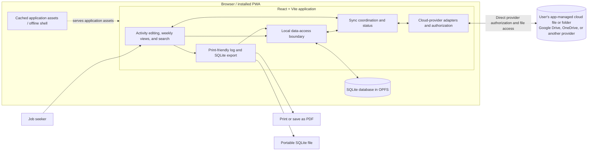

# Job-search tracker architecture

## Status and scope

This is a proposed architecture, not a description of implemented features.
The current project is a React and TypeScript Vite starter; it does not yet
provide a PWA, SQLite storage, export, or cloud synchronization.

The app is intended for one job seeker and one profile per installation. A
profile has a user-chosen label independent of the person's real name, and may
contain multiple unemployment-insurance claims. It will digitize
Washington Employment Security Department (ESD) job-search log information
and organize records for weekly filing. Users file their claims separately:
the app will not integrate with ESD systems, determine eligibility, or assess
compliance. Broader application tracking and attachment storage are deferred.

ESD's [job-search requirements and tracking guidance](https://esd.wa.gov/get-financial-help/unemployment-benefits/weekly-unemployment-claims/job-search-requirements)
links to the [official job-search log](https://esd.wa.gov/media/pdf/1045/esd-job-search-log-251110-accessiblepdf).
The log covers employer contacts, WorkSource activities, and other activities,
with some information specific to each type. It also asks what documentation
exists for certain activities; deferring attachments does not remove a user's
responsibility to retain supporting evidence when needed. ESD guidance can
change and remains the authoritative source.

## Proposed architecture

The UI reads and writes local records through a data-access boundary. The
offline shell caches application assets separately from the SQLite database;
it is not a backup of user data. Cloud synchronization is optional and uses
provider APIs directly from the browser, without an application backend.
Provider adapters are an abstraction for supporting different services; at
most one provider is connected at a time.

## Core workflows

- **Activity records:** Store common information plus activity-specific
  details. Automatically group activities by their dates into weekly views;
  users can correct dates and details. The precise fields and validation
  behavior remain open.
- **Onboarding:** Reuse existing storage or guide the user through local
  storage initialization and optional cloud setup, then create or open a
  claim. See the [onboarding user story](user-stories/onboarding.md) for the
  proposed profile and claim flow.
- **Search:** Find locally stored activities. Search fields and filters remain
  open.
- **Offline use:** After the app has been loaded at least once on a supported
  browser, activity editing, weekly views, search, and export should work
  without a network connection. A cloud account is not required for local use.
- **Export:** Provide a print-friendly log of all recorded activities that the
  browser can print or save as PDF. Separately, export a portable SQLite
  database representing a consistent state. The export method and whether
  portable data can be imported or restored are open decisions.
- **Cloud storage:** When connected, the app manages its own file or folder in
  the user's chosen provider. Occasional, best-effort synchronization is
  intended to support cross-device access and recovery from local data loss,
  but its guarantees and mechanisms are not yet defined. Display connection
  and sync status and clearly surface failures. On disconnect, let the user
  choose whether to retain or delete the app-managed cloud file; local records
  remain available.

## Platform and data considerations

- Target desktop and mobile browsers. Detect whether the required
  SQLite/OPFS approach is supported; if it is not, explain the limitation and
  block use rather than silently relying on an unsuitable fallback.
- Request persistent browser storage where supported and warn when durable
  storage is unavailable. Persistence is subject to browser behavior: local
  storage can still be cleared or lost. A cloud copy is not automatically a
  guaranteed backup.
- PWA installation, offline asset caching, and background execution vary by
  browser and platform. Do not assume sync will run while the app is closed,
  or that service workers can always access OPFS.
- Records and exports may contain sensitive personal and job-search
  information. Cloud copies rely on the provider's and user's account
  protections; app-managed encryption and key management are not required
  for now. Minimize requested provider permissions and account for the
  exposure of downloaded and printed exports.
- The official log asks for a name and ID or SSN. The app must never persist
  an SSN. A future print/PDF export may allow the user to provide one for
  that export without saving it in app storage; an export the user chooses
  to save or print may itself contain that information. Other identifying
  information, if any, remains a product and privacy decision.

## Open decisions

- Exact ESD log fields, activity types, week boundaries, validation, and
  whether incomplete records can be saved.
- SQLite/WASM implementation, data-access design, PWA tooling, and supported
  browser versions.
- Provider authorization and permissions, provider-specific file locations,
  and the cloud representation of data.
- Sync triggers, scheduling, transfer strategy, multi-device guarantees,
  conflict resolution, and recovery flow. No particular sync algorithm is
  implied by the diagram.
- Search fields and filters, SQLite export mechanics, and whether or how
  portable data can be imported or restored.
