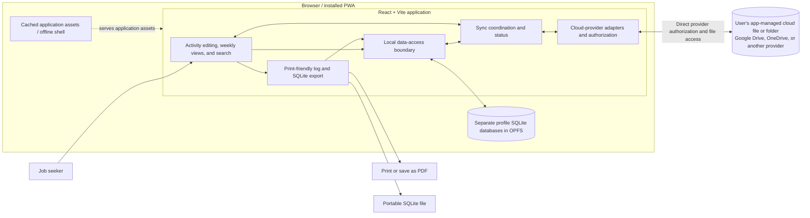

# Job-search tracker architecture

## Status and scope

Most of this architecture describes planned features. The React and TypeScript
Vite application has a worker-based SQLite/OPFS storage foundation and
capability/persistence reporting, isolated local profile persistence and
discovery, a landing page for profile creation and selection, and a
profile-scoped claims overview with a sidebar and selected-claim metadata, and
an optional simulated sync-setup dialog. Claim creation, PWA support, export,
and real cloud synchronization are not yet implemented.

The app supports multiple local profiles per installation, each backed by a
separate SQLite database. A profile has a user-chosen label independent of the
person's optional real name, and may contain multiple unemployment-insurance
claims. The real name is stored once per profile and applies across that
profile's claims, not across unrelated profiles. The app will digitize
Washington Employment Security Department (ESD) job-search log information
and organize records for weekly filing. Users file their claims separately:
the app will not integrate with ESD systems, determine eligibility, or assess
compliance. Broader application tracking and attachment storage are deferred.

ESD's [job-search requirements and tracking guidance](https://esd.wa.gov/get-financial-help/unemployment-benefits/weekly-unemployment-claims/job-search-requirements)
links to the [official job-search log](https://esd.wa.gov/media/pdf/1045/esd-job-search-log-251110-accessiblepdf).
The log covers employer contacts, WorkSource activities, and other activities,
with some information specific to each type. It also asks what documentation
exists for certain activities; deferring attachments does not remove a user's
responsibility to retain supporting evidence when needed. ESD guidance can
change and remains the authoritative source.

## Proposed architecture



The UI reads and writes local records through a data-access boundary. The
offline shell caches application assets separately from the SQLite database;
it is not a backup of user data. Cloud synchronization is optional and uses
provider APIs directly from the browser, without an application backend.
Provider adapters are an abstraction for supporting different services; at
most one provider is connected per profile at a time.

### Implemented storage foundation

The app uses the official
[`@sqlite.org/sqlite-wasm`](https://github.com/sqlite/sqlite-wasm) package and
its `opfs` VFS, running in a dedicated module worker. The UI never executes
SQLite directly. `src/storage/local-storage.ts` provides initialization,
open/create, parameter-bound SQL execution, close, and disposal. A session
owns one database connection at a time; close it before opening another.
Opening defaults to an existing file; creation must be requested explicitly.
Filenames are root-relative SQLite filenames such as `/profile-id.sqlite3`,
not display labels or `:memory:`.

The worker serializes requests, verifies the OPFS VFS is available, and always
opens databases with that VFS. There is no localStorage or in-memory fallback.
Initialization alone creates no profile, application schema, or database.
Callers must close/dispose their sessions; worker failures and timeouts reject
pending work rather than retrying potentially committed writes.

### Local profile persistence

`src/storage/profiles.ts` provides profile create, list, and open operations
outside React components. Each profile gets a stable UUID and a separate
`/profile-{uuid}.sqlite3` database; display labels are never used as
filenames. Discovery scans the OPFS root for only that exact profile filename
pattern, then reads and validates each candidate's metadata. A dedicated
catalog database is not used. Listing returns valid profiles and explicit
per-profile errors for matching files that cannot be read or have incomplete
or unsupported metadata; those files are never presented as usable profiles.

Each database stores one row in `profile_metadata` for its stable ID, required
label, optional real name, and creation timestamp. `PRAGMA user_version`
identifies schema version 3. New profile schema and metadata are initialized
in a SQLite transaction. Existing non-empty databases and IDs are rejected,
not reset or overwritten. Opening a version 1 profile migrates it in a
transaction by adding the claims table; opening a version 2 profile adds the
simulated setup-state table. Discovery can still list older profiles before
they are opened. A failed/incomplete database remains unlisted and is reported in
the listing errors so callers can surface the problem; other valid profiles
remain discoverable. No SSN field is stored. The profile open operation
verifies the filename ID, schema version, and metadata before returning a
profile-scoped SQLite session.

### Simulated sync setup

`src/sync/simulated-provider.ts` supplies display-only simulated cloud profiles
and a deterministic simulated connection result. The reusable setup dialog
does not authorize a real account or transfer, import, restore, merge, or
overwrite data. A successful setup is recorded in the selected profile's
`simulated_sync_setup` table, so state survives reloads without crossing
profiles. A simulated connected state is not evidence of synchronization or
backup.

The version 2 claims table is scoped to its profile database and stores a
stable claim ID, display identifier, app record creation timestamp, and
optional user-entered claim start date. The claim start date is distinct from
`created_at`; no claim-number validation is implied. The current claims UI is
read-only, and populated claim examples are test fixtures rather than
production demo data.

This approach requires HTTPS (localhost is allowed), module workers,
WebAssembly, SharedArrayBuffer/cross-origin isolation, and OPFS synchronous
access handles in workers. Vite development and preview send:

```text
Cross-Origin-Opener-Policy: same-origin
Cross-Origin-Embedder-Policy: require-corp
```

Production hosting must send these headers too, serve emitted worker/proxy
assets from the same origin, and serve `.wasm` as `application/wasm`. Deploy
the whole `dist` directory. Missing capabilities or failed WASM/OPFS
initialization block storage-dependent use with an explanation and retry;
they never select a weaker backend.

The upstream baseline for the required APIs is Chromium 108+, Firefox 111+,
and Safari 17+ (the selected `opfs` VFS does not support earlier Safari).
These are capability baselines, not a promise that every version works;
private browsing, permissions, quotas, and host configuration can interfere.
Automated browser tests verify Chromium and Firefox, including the production
bundle. The test matrix additionally enables WebKit on Linux/macOS, which
have not been verified on this Windows host. Windows WebKit launches but
times out starting SQLite's nested OPFS proxy in both development and
production; those projects are explicitly excluded on Windows.
Actual Safari/iOS and physical mobile compatibility remain to be verified.
See SQLite's [OPFS documentation](https://sqlite.org/wasm/doc/trunk/persistence.md)
for locking and browser restrictions. Multiple tabs can contend for files;
operations may fail and must not silently overwrite or reset storage.

The readiness UI reuses or requests persistent-storage permission separately
from database initialization. Pending permission (including a browser prompt)
does not block reads/writes. Denied, missing, or failing permission APIs
produce a warning, not a fake grant or a prohibition on otherwise supported
local storage. Even a grant does not protect against explicit browser-data
clearing or guarantee backup.

### Interactive storage diagnostics

`/diagnostics/storage` provides write/reopen, read, reload, and cleanup actions
for one synthetic SQLite record. It uses the same worker/data boundary as
future profile services. The reserved `/jst-storage-diagnostics.sqlite3`
filename must never be allocated to a profile. No profile database is opened.
Cleanup deletes only the synthetic row; it does not delete database files or
clear origin-wide browser storage.

The expected random token travels in the URL so a reload check compares
persisted data against an independent marker, not a newly generated record.
The marker is diagnostic data, not a credential. A changed/missing record
is a failure, including when another diagnostics tab replaces it. The page
also shows SQLite version and write time. It is intended for real-browser
and device checks in addition to Playwright, not as a backup guarantee.
Production hosts need an SPA fallback for the diagnostics URL.

## Core workflows

- **Activity records:** Store common information plus activity-specific
  details. Automatically group activities by their dates into weekly views;
  users can correct dates and details. The precise fields and validation
  behavior remain open.
- **Onboarding:** List existing local profiles or guide the user through
  creating a named profile with an optional real name and optional cloud
  setup, then open its claims overview (which may be empty). Initial setup
  uses a clearly labeled simulated cloud provider; real cloud connectivity
  and claim creation are deferred. See the
  [onboarding user story](user-stories/onboarding.md).
- **Search:** Find locally stored activities. Search fields and filters remain
  open.
- **Offline use:** After the app has been loaded at least once on a supported
  browser, activity editing, weekly views, search, and export should work
  without a network connection. A cloud account is not required for local use.
- **Export:** Provide a print-friendly log of all recorded activities that the
  browser can print or save as PDF. Separately, export a portable SQLite
  database representing a consistent state. The export method and whether
  portable data can be imported or restored are open decisions.
- **Cloud storage:** When connected, the app manages its own file or folder in
  the user's chosen provider. Occasional, best-effort synchronization is
  intended to support cross-device access and recovery from local data loss,
  but its guarantees and mechanisms are not yet defined. Display connection
  and sync status and clearly surface failures. On disconnect, let the user
  choose whether to retain or delete the app-managed cloud file; local records
  remain available.

## Platform and data considerations

- Target desktop and mobile browsers. Detect whether the required
  SQLite/OPFS approach is supported; if it is not, explain the limitation and
  block use rather than silently relying on an unsuitable fallback.
- Request persistent browser storage where supported and warn when durable
  storage is unavailable. Persistence is subject to browser behavior: local
  storage can still be cleared or lost. A cloud copy is not automatically a
  guaranteed backup.
- PWA installation, offline asset caching, and background execution vary by
  browser and platform. Do not assume sync will run while the app is closed,
  or that service workers can always access OPFS.
- Records and exports may contain sensitive personal and job-search
  information. Cloud copies rely on the provider's and user's account
  protections; app-managed encryption and key management are not required
  for now. Minimize requested provider permissions and account for the
  exposure of downloaded and printed exports.
- The official log asks for a name and ID or SSN. The app must never persist
  an SSN. A future print/PDF export may allow the user to provide one for
  that export without saving it in app storage; an export the user chooses
  to save or print may itself contain that information. Other identifying
  information, if any, remains a product and privacy decision.

## Open decisions

- Exact ESD log fields, activity types, week boundaries, validation, and
  whether incomplete records can be saved.
- Profile schema/versioning and discovery, PWA tooling, and verified support
  across additional browsers and mobile platforms.
- Provider authorization and permissions, provider-specific file locations,
  and the cloud representation of data.
- Sync triggers, scheduling, transfer strategy, multi-device guarantees,
  conflict resolution, and recovery flow. No particular sync algorithm is
  implied by the diagram.
- Search fields and filters, SQLite export mechanics, and whether or how
  portable data can be imported or restored.
